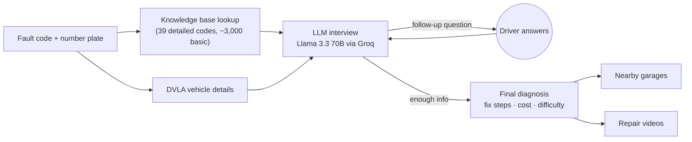

# AutoClarity

**Turns a car's warning-light fault code into a plain-English diagnosis, a repair cost estimate and a nearby garage.**

When a check-engine light comes on, a code reader gives you something like `P0300`. That means little to most drivers, so they go to a mechanic without knowing what's likely wrong or what a fair price is. AutoClarity asks a few follow-up questions, works out the most likely cause, and explains it in plain English.

Built solo as a personal project in 2026.

---

## Features

| Feature | What it does |
|---|---|
| **AI diagnosis** | Enter a fault code (and optionally a UK number plate). The AI asks follow-up questions one at a time, then gives a final diagnosis with fix steps, an estimated cost in GBP and a difficulty rating |
| **Fault-code lookup** | Look up any of about 3,000 OBD-II codes for its title, system and severity |
| **Vehicle details** | Pulls make, model and other details from the DVLA by number plate, plus an optional VIN lookup |
| **Nearby garages** | Finds local mechanics using Google Maps results |
| **Repair videos** | Suggests YouTube videos that match the diagnosis |
| **Accounts and history** | Sign up, log in and see past diagnoses |

---

## How it works



1. **Ground the AI.** 39 common codes have hand-written causes, likelihoods, costs and diagnostic questions. These are added to the model's instructions so its answers are based on real data, not guesses. About 3,000 more codes from a CSV dataset supply the title, system and severity.
2. **Interview.** The model asks one question at a time to narrow down the cause.
3. **Diagnose.** It returns a structured JSON diagnosis. If the JSON is invalid, the app falls back to showing the raw text instead of failing.

---

## Tech stack

- **Frontend:** React (Vite), React Router, Context for auth, Axios
- **Backend:** Node.js, Express, Prisma, PostgreSQL
- **Security:** JWT authentication, bcrypt password hashing, rate limiting on the API
- **APIs:** Groq (Llama 3.3 70B), DVLA Vehicle Enquiry, SerpAPI (Google Maps), YouTube Data API, VIN decoder (optional)

---

## Run it locally

### 1. Requirements

- Node.js 18 or later
- PostgreSQL 14 or later
- API keys for Groq, DVLA, SerpAPI and YouTube (all have free tiers or trial access)

### 2. Create the database

```bash
psql -U postgres -c "CREATE DATABASE auto_clarity;"
```

### 3. Backend

```bash
cd backend
npm install
cp .env.example .env      # then fill in your values
npx prisma migrate deploy
npm run dev
```

The API runs at http://localhost:5001.

### 4. Frontend

In a new terminal:

```bash
cd frontend
npm install
npm run dev
```

Open http://localhost:5173.

### Troubleshooting

If the frontend won't start, delete `node_modules` and `package-lock.json` in `frontend/`, then run `npm install` again.

---

## API

| Route | Method | Purpose |
|---|---|---|
| `/api/auth/register`, `/api/auth/login`, `/api/auth/me` | POST, POST, GET | Accounts |
| `/api/obd/code/:code`, `/api/obd/codes` | GET | Fault-code lookup |
| `/api/obd/session/start`, `/api/obd/session/answer` | POST | AI diagnosis interview |
| `/api/vehicle/reg/:plate`, `/api/vehicle/vin/:vin` | GET | Vehicle details |
| `/api/mechanic/nearby` | GET | Nearby garages |
| `/api/youtube/search` | GET | Repair videos |
| `/api/history` | GET, POST, DELETE | Saved diagnoses |

---

## Project structure

```
├── backend/
│   ├── prisma/              # Database schema and migrations
│   └── src/
│       ├── index.js         # Express app, CORS, rate limiting
│       ├── routes/          # 6 route groups
│       ├── controllers/     # Route logic
│       ├── services/groq.js # LLM calls and JSON parsing
│       ├── middleware/      # JWT auth
│       └── data/            # Fault-code knowledge base (JSON + CSV)
└── frontend/
    └── src/
        ├── pages/           # Dashboard, Diagnose, History, Mechanic, VIN lookup, Login, Register
        ├── context/         # Auth state
        └── api/             # Axios client
```

---

## Limitations

- **A prototype, not a mechanic.** Diagnoses are a starting point for a conversation with a garage, not a replacement for one.
- Only 39 codes have detailed hand-written data. For the rest, the AI relies on the basic code description and its general knowledge.
- Cost estimates are rough UK averages and will vary by car and garage.

## What's next

- Expand the detailed knowledge base beyond 39 codes
- Deploy a live demo
- Add tests for the diagnosis flow and API

---

**Muddasir Khan** · [LinkedIn](https://www.linkedin.com/in/muddasir-khan-/) · [GitHub](https://github.com/Mxddasir)
